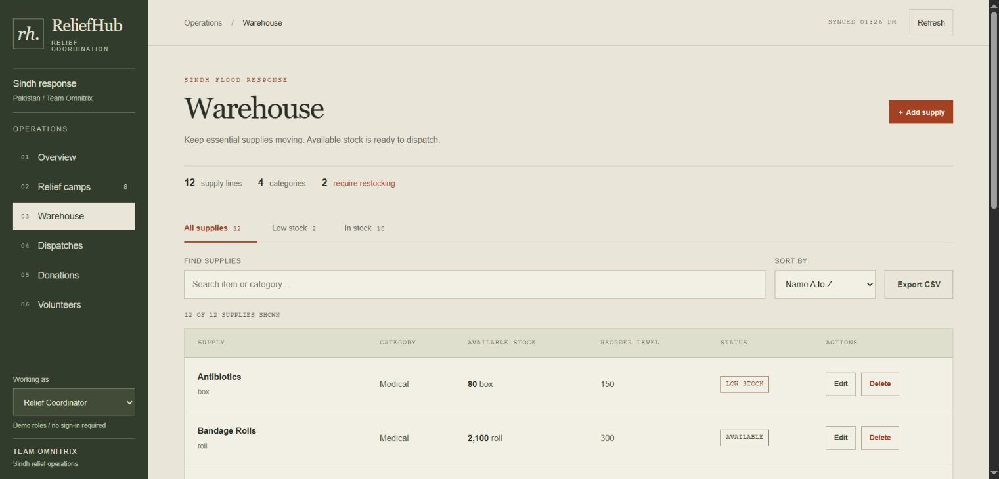

# ReliefHub 🌊

### Flood Relief Coordination & Resource Management System

**Team Omnitrix | HacktoberFest 3.0**

ReliefHub is a web-based dashboard designed to make flood-relief coordination easier and more organized. It brings relief camps, supply inventories, urgent needs, deliveries, donations, and volunteers into one workspace, helping coordinators see where assistance is needed and track how resources are used.

The current application is a **working local Flask + SQLite demo**, built around flood-relief operations in Sindh, Pakistan.



## Key Features

| Module | What it does |
| --- | --- |
| **Overview Dashboard** | Displays active camps, sheltered families, fulfilment progress, low-stock items, deployed volunteers, recent dispatches, and critical supply gaps. |
| **Relief Camps** | Create, update, search, and manage camps, capacities, family counts, districts, and statuses. |
| **Warehouse & Inventory** | Track available supplies by item, category, and unit; identify low-stock items; search, sort, and export records to CSV. |
| **Camp Needs** | Record requested supplies, set High/Medium/Low priorities, and monitor fulfilled and outstanding quantities. |
| **Dispatch Management** | Reserve available stock, track deliveries through their statuses, and restore stock when pending deliveries are cancelled. |
| **Donations** | Record monetary and in-kind donations; automatically add received physical supplies to inventory. |
| **Volunteer Management** | Register volunteers, filter by skill, and assign or unassign them from relief camps. |

### Highlights

- Responsive dashboard with an olive-and-earth-tone visual style.
- Search, filters, sortable warehouse records, and CSV export.
- Alerts for **high-priority needs below 40% fulfilment**.
- Low-stock identification based on each item's reorder level.
- Validation to prevent dispatching more stock than is available or required.
- Transaction-based updates to protect stock and fulfilment calculations.
- Demo role permissions for a **Relief Coordinator (Admin)** and a **Field Volunteer**.

## Technology Stack

| Layer | Technology |
| --- | --- |
| Frontend | HTML5, CSS3, vanilla JavaScript |
| Backend | Python, Flask 3.0.3 |
| Database | SQLite3 |
| API | Flask REST-style JSON endpoints |
| Testing | Python `unittest` |

There is no Node.js build process or external API requirement for local use.

## Getting Started

### Requirements

- Python **3.10 or newer**
- Git (for cloning the repository)
- A modern web browser

### 1. Clone the repository

```bash
git clone --branch omnitrix https://github.com/his012/Team_Omnitrix.git
cd Team_Omnitrix/submission/omnitrix/reliefhub
```

If the repository is already downloaded, simply open its `submission/omnitrix/reliefhub` folder in a terminal.

### 2. Install dependencies

```bash
python -m pip install -r requirements.txt
```

> **Windows users:** Gunicorn may appear in `requirements.txt` for Linux hosting, but you do **not** need to run Gunicorn locally.

### 3. Start ReliefHub

```bash
python app.py
```

Visit **http://127.0.0.1:5050** in your browser.

On the first launch, the application creates `reliefhub.db` and loads demonstration records. Later runs reuse the existing database so your local changes are preserved.

If port `5050` is unavailable:

```bash
python app.py --port 5051
```

Then open `http://127.0.0.1:5051`.

## Project Structure

```text
reliefhub/
├── app.py               # Flask application, APIs, and business rules
├── schema.sql           # SQLite table definitions
├── seed.py              # Initial demo records
├── requirements.txt     # Python dependencies
├── test_app.py          # Automated tests
├── preview.jpg          # Dashboard preview
├── static/
│   ├── index.html       # Page structure
│   ├── styles.css       # Responsive styling
│   └── app.js           # Dashboard logic and API requests
└── reliefhub.db         # Created locally; not committed to Git
```

## Demo Dataset

The included starter data covers:

| Record type | Sample records |
| --- | ---: |
| Relief camps | 8 |
| Inventory items | 12 |
| Camp needs | 20 |
| Dispatches | 10 |
| Donations | 10 |
| Volunteers | 15 |

The data includes different camp statuses, low-stock items, and urgent requests so the dashboard can be demonstrated immediately.

**Resetting demo data:** Stop the app, back up or move `reliefhub.db`, and run `python app.py` again. The seeding script will not overwrite an existing database.

## API Endpoints

The frontend communicates with the Flask backend through same-origin JSON requests.

| Method | Endpoint | Purpose |
| --- | --- | --- |
| `GET` | `/api/camps` | List camps |
| `GET` | `/api/inventory` | List warehouse items |
| `GET` | `/api/needs` | List camp needs |
| `GET` | `/api/dispatches` | List dispatches |
| `GET` | `/api/donations` | List donations |
| `GET` | `/api/volunteers` | List volunteers |
| `GET` | `/api/<collection>/<id>` | Retrieve a single record |
| `POST` | `/api/<collection>` | Create a record where supported |
| `PUT` | `/api/<collection>/<id>` | Update a record where supported |
| `DELETE` | `/api/<collection>/<id>` | Delete eligible records |
| `GET`, `POST` | `/api/session` | View or switch the demo role |

Some operations are intentionally restricted. For example, dispatch and donation history is retained rather than deleted.

### Dispatch Workflow

```text
Pending → In Transit → Delivered
    │           │
    └───────────┴──────→ Cancelled
```

- Creating a dispatch immediately reserves stock.
- Marking it **Delivered** increases the fulfilled quantity of the associated need.
- Cancelling an undelivered dispatch returns its reserved stock.
- Delivered and Cancelled dispatches are final; repeated status updates do not double-count quantities.

## Demo Roles

**Relief Coordinator (Admin)** can manage relief operations across the application.

**Field Volunteer** can view information, update camp family counts, and create or edit camp needs, subject to server-side restrictions.

> **Security note:** The role selector is designed for demonstration and is **not real user authentication**. Do not use this version for sensitive relief records or a public production service without implementing proper login, access control, and secure persistent storage.

## Run Tests

From the `reliefhub` directory, run:

```bash
python -m unittest -v test_app
```

The test suite covers validation, role restrictions, stock reservation, dispatch status changes, donations, volunteer assignment, database persistence, and concurrent operations. Tests use separate temporary databases.

## Suggested Demo Walkthrough

1. Open **Overview** and review the critical relief gaps.
2. Open a camp and inspect its current supply needs.
3. Create a dispatch within the available warehouse stock.
4. Move the dispatch to **In Transit**, then **Delivered**.
5. Check how the fulfilment percentage changes.
6. Record an in-kind donation and confirm the inventory update.
7. Assign a volunteer to an available camp.
8. Switch to **Field Volunteer** to demonstrate restricted operations.

## Deployment Status

- **Supported today:** Local Flask application with persistent SQLite storage on the local machine.
- **Netlify:** The frontend files can be hosted there, but a frontend-only upload will **not** run the Flask API.
- **Supabase:** A PostgreSQL/Edge Functions migration was discussed but is **not part of the current working application**.
- **Public deployment:** Requires a compatible backend runtime, a persistent database, and real authentication/authorization before operational use.

This README intentionally describes implemented features rather than claiming a cloud deployment that has not been verified.

## Team Omnitrix

| Member | GitHub |
| --- | --- |
| Farhan | [@his012](https://github.com/his012) |
| Zain Arshad | [@zain-arshad-arain](https://github.com/zain-arshad-arain) |
| Huzaifa Abbasi | [@HuzaifaAbbasi6901](https://github.com/HuzaifaAbbasi6901) |

**Repository:** [his012/Team_Omnitrix](https://github.com/his012/Team_Omnitrix/tree/omnitrix/submission/omnitrix/reliefhub)  
**HacktoberFest reference:** [Issue #10](https://github.com/AWSCloudClubMuet/HacktoberFest-3.0/issues/10)

---

**ReliefHub — Coordinating resources where they matter most.**
